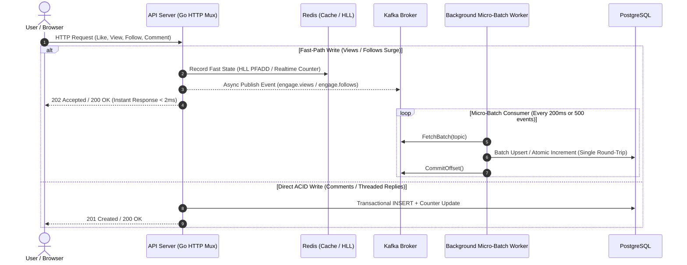
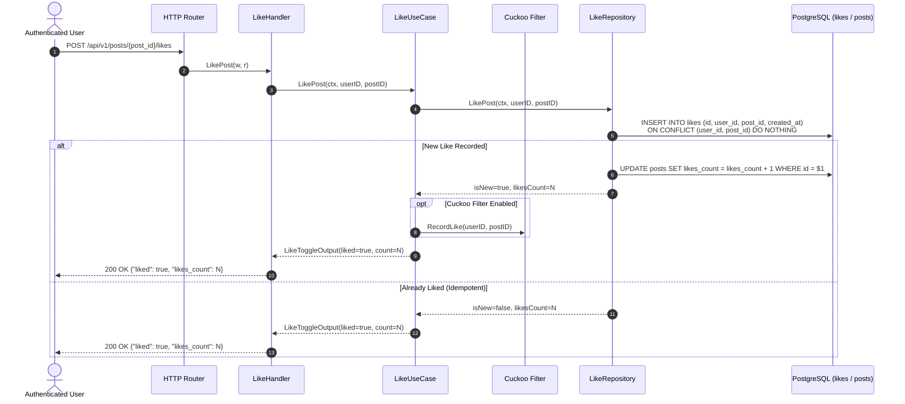
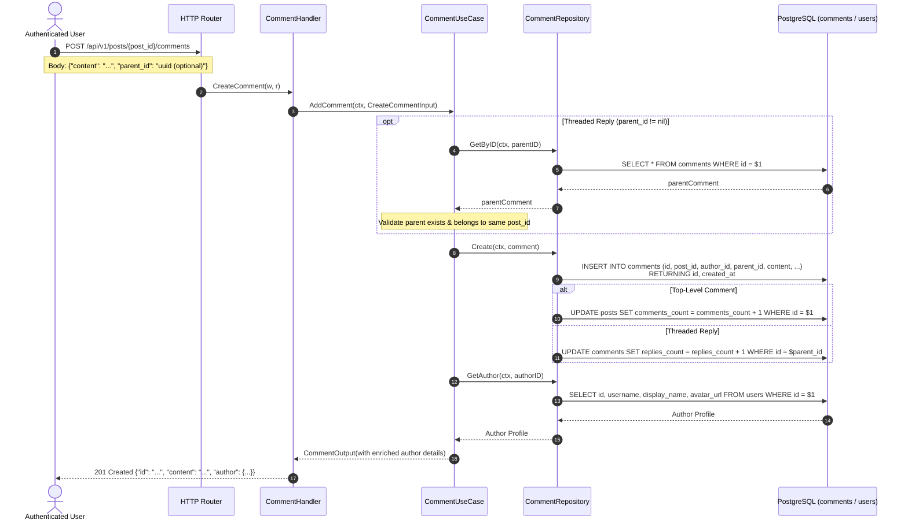
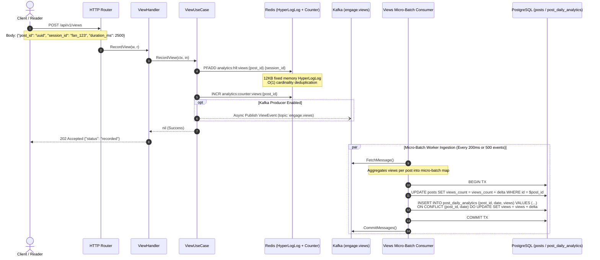
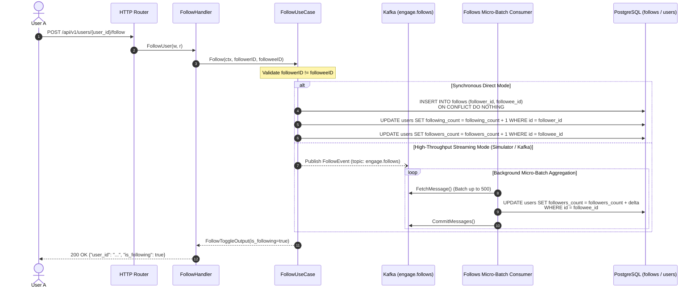
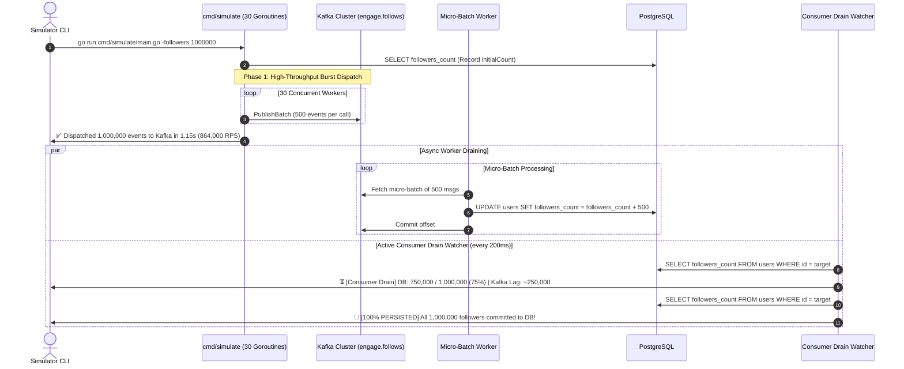

<div align="center">


# engage-engine

**High-Throughput Social Engagement Engine — Distributed Systems Architecture in Go**

[](https://go.dev/)
[](https://www.postgresql.org/)
[](https://redis.io/)
[](https://kafka.apache.org/)
[](https://www.docker.com/)
[](https://newrelic.com/)

<p align="center">
  
</p>

</div>

---

`engage-engine` is a scalable, production-oriented Go backend structured as a **Feature-Based Modular Monolith** combined with **Clean Architecture** principles. Designed to effortlessly survive massive viral engagement surges, it integrates **Redis HyperLogLog** for fixed-memory (12KB) cardinality deduplication, **Kafka micro-batching** for lock-free database write-behind persistence, and **probabilistic Cuckoo filters** for sub-millisecond membership checks.

---

## 🛠️ Tech Stack & Key Libraries

| Technology / Library | Purpose & Implementation Details | Logo / Badge |
| :--- | :--- | :---: |
| **Go (Golang)** | High-concurrency core runtime using standard library `net/http` router |  |
| **PostgreSQL (`pgx/v5`)** | ACID datastore with high-performance connection pooling (`puddle`) and raw SQL |  |
| **Redis (`go-redis/v9`)** | HyperLogLog (`PFADD`/`PFCOUNT`), pipelined atomic counters, and cache |  |
| **Apache Kafka (`kafka-go`)** | Distributed event streaming (`engage.views`, `engage.follows`, `engage.likes`) |  |
| **New Relic (`go-agent/v3`)** | Distributed tracing & APM profiling with `nrpgx5` and `nrredis-v9` datastore hooks |  |
| **Zerolog (`rs/zerolog`)** | High-performance, zero-allocation structured JSON logging |  |
| **Validator (`validator/v10`)** | Declarative request payload & struct constraint validation |  |
| **JWT (`golang-jwt/v5`)** | Secure stateless authentication & token claim validation |  |
| **Docker & Docker Compose** | Multi-stage Docker builds and automated local development orchestration |  |

---

## 1. Project Structure

```text
engage-engine/
├── cmd/
│   ├── api/
│   │   └── main.go               # HTTP API server entry point
│   └── worker/
│       └── main.go               # Background worker / event consumer entry point
│
├── internal/
│   ├── modules/                  # Independent feature modules (Clean Architecture)
│   │   ├── user/
│   │   │   ├── domain/
│   │   │   ├── usecase/
│   │   │   ├── repository/
│   │   │   └── handler/
│   │   ├── post/
│   │   │   ├── domain/
│   │   │   ├── usecase/
│   │   │   ├── repository/
│   │   │   └── handler/
│   │   ├── like/
│   │   │   ├── domain/
│   │   │   ├── usecase/
│   │   │   ├── repository/
│   │   │   └── handler/
│   │   ├── comment/
│   │   │   ├── domain/
│   │   │   ├── usecase/
│   │   │   ├── repository/
│   │   │   └── handler/
│   │   ├── follow/
│   │   │   ├── domain/
│   │   │   ├── usecase/
│   │   │   ├── repository/
│   │   │   └── handler/
│   │   ├── notification/
│   │   │   ├── domain/
│   │   │   ├── usecase/
│   │   │   ├── repository/
│   │   │   └── handler/
│   │   └── views/
│   │       ├── domain/
│   │       ├── usecase/
│   │       ├── repository/
│   │       └── handler/
│   │
│   ├── platform/                 # Infrastructure & technology adapters
│   │   ├── mongodb/              # Primary document database
│   │   ├── postgres/             # Optional relational database (pgxpool)
│   │   ├── redis/                # Caching & HyperLogLog
│   │   ├── kafka/                # Asynchronous event streaming
│   │   ├── logger/               # Structured logging (zerolog)
│   │   ├── config/               # Configuration management (koanf + validator)
│   │   └── server/               # HTTP server lifecycle & graceful shutdown
│   │
│   └── shared/                   # Cross-cutting primitives (no business logic)
│       ├── errors/               # Structured HTTP & domain errors
│       ├── response/             # Standard API envelopes
│       └── pagination/           # Pagination models
│
├── deployments/
│   ├── docker/                   # Multi-stage Dockerfiles
│   │   ├── Dockerfile.api
│   │   └── Dockerfile.worker
│   ├── nginx/                    # Nginx reverse proxy configuration
│   │   └── nginx.conf
│   └── docker-compose.yml        # Local development infrastructure
│
├── docs/
│   ├── architecture.md           # Architecture guidelines & dependency rules
│   └── database_models.md        # Database documentation & schemas
│
├── scripts/
│   └── setup.sh                  # Local bootstrap script
│
├── tests/
│   ├── integration/              # Integration test suites
│   └── load/                     # Load and performance tests
│
├── .env.example                  # Environment configuration blueprint
├── .gitignore                    # Git ignore file
├── Makefile                      # Standard development commands (Make)
├── Taskfile.yml                  # Task runner workflow pipeline (Task)
└── go.mod                        # Go module definition
```

---

## 2. Architectural Principles

1. **Feature-Based Modular Monolith**: Code is partitioned by business capabilities (`user`, `post`, `like`, `comment`, `follow`, `views`, `notification`) rather than horizontal technical layers.
2. **Clean Architecture Inside Modules**: Each module has its own `domain/`, `usecase/`, `repository/`, and `handler/http/` packages. Domain logic remains independent of databases and frameworks.
3. **Repository Interface Colocation**: Repository interfaces are defined inside each module's `repository/` package, close to the use cases that consume them.
4. **Platform Infrastructure Isolation**: Concrete drivers for MongoDB, PostgreSQL, Redis, and Kafka remain isolated inside `internal/platform/`.
5. **Dependency Inversion**: Dependencies flow inward. Use cases depend only on domain entities and repository interfaces. Implementations are injected through constructors.
6. **No Circular Dependencies**: Feature modules must not import each other cyclically.

For more details on architecture and data models, see:
- [docs/architecture.md](docs/architecture.md)
- [docs/database_models.md](docs/database_models.md)

---

## 3. System Architecture & Module Sequence Diagrams

`engage-engine` handles intense social engagement spikes using **in-memory probabilistic data structures**, **Kafka message streaming**, and **asynchronous micro-batch consumers** to eliminate row-level lock contention on PostgreSQL.

### 3.1. Overall Distributed Flow



---

### 3.2. Likes Module (`internal/modules/like`)

Coordinates liking and unliking of posts and comments with idempotent database updates and probabilistic deduplication via Cuckoo Filters.



---

### 3.3. Comments Module (`internal/modules/comment`)

Supports threaded discussions (replies) and paginated comment feeds using keyset (cursor) pagination.



---

### 3.4. Views & HyperLogLog Module (`internal/modules/views`)

High-throughput view tracking with **Redis HyperLogLog** for unique audience estimation (fixed 12KB memory) and **Kafka micro-batching** for persistent analytics in PostgreSQL.



---

### 3.5. Follows Module (`internal/modules/follow`)

Manages the social graph. Supports direct execution or high-throughput Kafka streaming with micro-batched database counter updates.



---

### 3.6. Traffic Simulator & Consumer Drain (`cmd/simulate`)

Simulates high-velocity traffic (up to 1,000,000+ RPS) and actively monitors background consumer drain progress.



---

## 4. Getting Started

### Prerequisites

- Go `1.22+`
- Make (or [Task](https://taskfile.dev))
- Docker & Docker Compose (optional for local containers)

### Setup

```bash
./scripts/setup.sh
```

### Common Commands

| Command (Make) | Command (Task) | Description |
| :--- | :--- | :--- |
| `make build` | `task build` | Compile `api` and `worker` binaries into `bin/` |
| `make run-api` | `task run-api` | Run the HTTP API server |
| `make run-worker` | `task run-worker` | Run the background worker service |
| `make test` | `task test` | Run unit tests with race detection |
| `make fmt` | `task fmt` | Format all Go source files |
| `make vet` | `task vet` | Run Go static analysis |
| `make clean` | `task clean` | Clean build artifacts |
| `make docker-up` | `task docker-up` | Spin up infrastructure containers |
| `make docker-down` | `task docker-down` | Tear down infrastructure containers |
